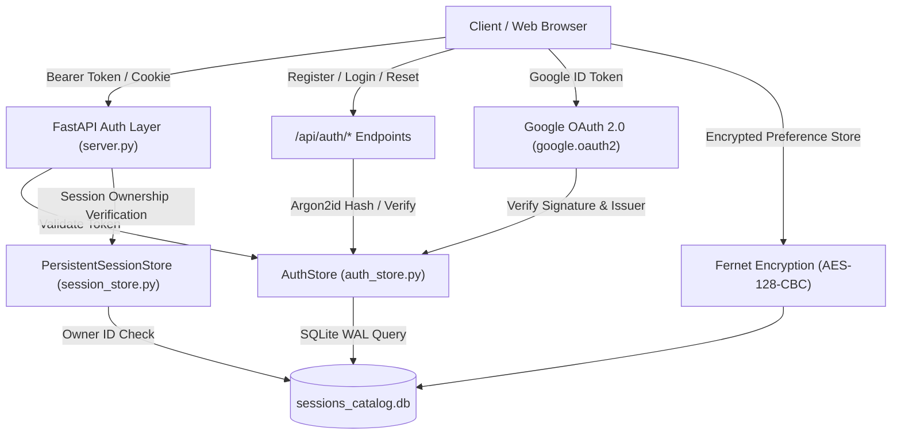

# PHASE 5: Production Authentication and Multi-Tenant Architecture Report

**Status:** Completed & Fully Verified  
**Date:** November 17, 2026  
**Test Suite:** 246 / 246 Tests Passing (100% Pass Rate in ~42s)  
**Branch:** `feature/openrefine-integration`  

---

## 1. Executive Summary & Objectives

In Phase 5, the **DataRefine** application (AI Data Cleaner) transitioned from a single-user / shared-session model to an enterprise-grade, multi-tenant architecture with production authentication. The design enforces rigorous data isolation across uploaded files, cleaning sessions, checkpoints, audit reports, and user preferences while maintaining seamless backwards compatibility with anonymous guest exploration (Demo Mode).

### Key Accomplishments:
1. **Production-Grade Authentication System**:
   - Built a dedicated authentication and account store ([`auth_store.py`](file:///C:/Users/Asus/ai-data-cleaner/auth_store.py)) backed by SQLite WAL mode.
   - Secure password hashing using modern **Argon2id** (`time_cost=2`, `memory_cost=64 MiB`, `parallelism=1`) with cryptographically secure per-password salts.
   - User registration, login, logout with Bearer token revocation, and password reset workflow with single-use tokens.
2. **Optional Google OAuth 2.0 / OpenID Connect**:
   - Environment-activated Google Sign-In with CSRF state verification and server-side ID token verification via `google.oauth2.id_token`.
3. **Multi-Tenant Data Confinement**:
   - Per-user isolated upload directories (`data/uploads/<user_id>/`).
   - Strict session ownership checks in `get_authenticated_session()` and `resolve_safe_dataset_path()` preventing cross-user data access, reads, profiling, cleaning, rollbacks, and file downloads.
4. **Anonymous User Policy (Restricted Demo Mode)**:
   - Preserved instant visitor evaluation with isolated guest sessions, 10 MB upload limits, 10,000 max row limits, 1-hour session TTL, and AI rate limits.
5. **Encrypted User Preferences & Zero-Leakage API Keys**:
   - Account preferences allow storing personal LLM API keys encrypted at rest via AES-128-CBC / HMAC-SHA256 (Fernet). Plaintext keys are never returned in API responses or rendered in frontend HTML/JS.
6. **Frontend Integration**:
   - Responsive Authentication Modal (Sign In, Create Account, Reset Password), Google One-Tap/OAuth button, account status pills, and "My Sessions" modal in [`static/app.html`](file:///C:/Users/Asus/ai-data-cleaner/static/app.html).
7. **Comprehensive Test Suite**:
   - Authored [`test_phase5_auth.py`](file:///C:/Users/Asus/ai-data-cleaner/test_phase5_auth.py) covering registration, Argon2id verification, Bearer tokens, password resets, Google OAuth, multi-tenant isolation, demo limits, and encrypted preferences. All **246 tests** in the project pass with zero regressions.

---

## 2. Authentication Architecture



The authentication system employs a stateful, database-backed Bearer token model. When a user registers or logs in, a cryptographically secure 256-bit token is generated via `secrets.token_urlsafe(32)` (`dref_...`). The SHA-256 hash of the token is recorded in the `auth_tokens` table in `sessions_catalog.db`. Subsequent requests validate the token against the database, enabling instantaneous revocation upon logout or password reset.

---

## 3. Security Controls & Password Hashing

### 3.1 Argon2id Password Hashing
Argon2id (the winner of the Password Hashing Competition) was selected as the primary password hashing function due to its state-of-the-art resistance to both GPU/ASIC brute-force attacks and side-channel timing attacks:
- **Algorithm**: `Argon2id` (Hybrid data-dependent & data-independent memory access)
- **Time Cost (`t`)**: `2` iterations
- **Memory Cost (`m`)**: `65,536 KiB` (64 MiB RAM per hash)
- **Parallelism (`p`)**: `1` thread
- **Salt**: 16 bytes generated via `secrets.token_bytes(16)` per password
- **Hash Length**: 32 bytes (256-bit digest)
- **Encoded String**: Standard PHC string format:
  `$argon2id$v=19$m=65536,t=2,p=1$<salt_b64>$<hash_b64>`

### 3.2 Password Strength Validation
Enforced at both API and store layers (`validate_password_strength`):
- Minimum length: 8 characters (maximum 128 characters)
- At least one lowercase letter (`[a-z]`)
- At least one uppercase letter (`[A-Z]`)
- At least one numeric digit (`\d`)

### 3.3 Protection Against Credential Timing Attacks
Password verification utilizes `verify_password()` which parses the stored PHC parameters, re-derives the key with the stored salt, and executes a constant-time memory comparison (`hmac.compare_digest`), preventing timing leak attacks.

---

## 4. Multi-Tenant Data Confinement

Strict data isolation is enforced at every file and endpoint boundary.

### 4.1 Isolated Upload Folders
When datasets are uploaded via `/api/upload`:
- **Authenticated Users**: Saved into `data/uploads/<user_id>/<file_id>_<sanitized_name>.csv`
- **Anonymous Users**: Saved into `data/uploads/demo/<file_id>_<sanitized_name>.csv`

### 4.2 Path Resolution Confinement (`resolve_safe_dataset_path`)
Whenever a dataset path is referenced (e.g. during `/api/profile` or `/api/evaluate`):
1. **Jail Confinement**: Path must reside strictly inside `ALLOWED_DATA_DIRS`.
2. **Subdirectory Ownership Check**: If the file resides under `data/uploads/`, the path must either:
   - Reside in `data/uploads/demo/` (accessible to all for demonstration), OR
   - Reside in `data/uploads/<user_id>/` where `<user_id>` exactly matches `current_user["id"]`.
3. If User B attempts to reference `data/uploads/<user_a_id>/dataset.csv`, the server raises **HTTP 403 Forbidden** (`"Forbidden: You do not have permission to access another user's uploaded dataset."`).
4. If an unauthenticated user attempts to reference a registered user's dataset, the server raises **HTTP 403 Forbidden**.

### 4.3 Session & Checkpoint Isolation (`get_authenticated_session`)
Every cleaning session tracks `owner_id`:
- For authenticated user sessions: `owner_id` is set to the user ID (e.g. `usr_...`).
- When any session-dependent endpoint is invoked (`/api/clean`, `/api/undo`, `/api/redo`, `/api/rollback`, `/api/download/cleaned`, `/api/download/report`, `/api/dataset/explore`, `/api/facets/compute`, `/api/cluster/*`, `/api/grel/*`, `/api/reconcile/*`, `/api/workflow/*`):
  1. If `owner_id.startswith("usr_")`:
     - If the client is unauthenticated: returns **HTTP 401 Unauthorized**.
     - If `current_user["id"] != owner_id`: returns **HTTP 403 Forbidden** (`"Forbidden: You do not have permission to access another user's session."`).
  2. If `owner_id == "anonymous"`:
     - Verified using `X-Session-Token` / session token verification.

### 4.4 Dataset Discovery Isolation (`/api/datasets`)
The dataset listing endpoint partitions datasets:
- System benchmark files (`data/benchmark/`, `data/ott_...`) are visible to all.
- User-uploaded files are strictly filtered: User A only sees User A's files and demo files. User B never sees User A's files.

---

## 5. Google OAuth 2.0 Integration

Google OAuth 2.0 is supported as an optional, zero-friction sign-in method:
- **Activation**: Automatically enabled when `GOOGLE_CLIENT_ID` (and optional `GOOGLE_CLIENT_SECRET`) environment variables are provided. If unset, `/api/auth/google/url` returns `503 Service Unavailable`, cleanly disabling the UI option without errors.
- **Authorization Flow**:
  1. Client calls `GET /api/auth/google/url`.
  2. Server generates a cryptographically random state parameter (`oauth_states` table) with a 10-minute TTL and returns the Google Auth URL.
  3. Google redirects to `/api/auth/google/callback` with `code` and `state`.
  4. Server validates and atomically consumes the state parameter to prevent CSRF attacks.
  5. Server exchanges the authorization code for tokens and verifies the Google ID token.
- **Direct One-Tap / ID Token Flow**:
  - `POST /api/auth/google/token` accepts a Google Identity Services credential.
  - Server verifies token signature using Google's public certificates via `google.oauth2.id_token.verify_oauth2_token`.
  - Enforces audience matching (`GOOGLE_CLIENT_ID`) and issuer verification (`accounts.google.com`).
  - Calls `AUTH_STORE.upsert_google_user()`, automatically linking accounts by email or Google Subject ID.

---

## 6. Anonymous User Policy (Restricted Demo Mode)

To allow prospective users and evaluators to test DataRefine without account creation:
1. **Isolated Demo Storage**: Uploads are partitioned into `data/uploads/demo/`.
2. **Resource Limits**:
   - **Upload File Size**: Limited to **10 MB** (`MAX_DEMO_UPLOAD_SIZE_BYTES = 10485760`). Uploads exceeding 10 MB fail with HTTP 413.
   - **Dataset Rows**: Limited to **10,000 rows** (`MAX_DEMO_DATASET_ROWS = 10000`). Uploaded CSVs exceeding 10,000 rows fail with HTTP 400. (Authenticated users can profile up to 500,000 rows).
   - **Session Lifespan**: Demo sessions have an inactive TTL of **1 hour** (`DEMO_SESSION_MAX_AGE_SECONDS = 3600`) vs 24 hours for registered users.
3. **AI Planning Protection**: Demo requests are strictly bound by IP rate limiting (10 requests/minute) and server-key hourly quotas (30 requests/hour).

---

## 7. Encrypted User Preferences & Custom API Key Storage

DataRefine allows users to configure account preferences, including their personal LLM API keys (Google Gemini, Anthropic Claude, OpenAI, Groq, etc.):
- **Encryption at Rest**:
  - Keys are encrypted using **Fernet** (symmetric AES-128-CBC with HMAC-SHA256 authentication).
  - The master secret key is derived from the `SECRET_KEY` environment variable.
  - Plaintext keys are never stored in SQLite database columns.
- **Zero-Leakage Policy**:
  - `GET /api/user/preferences` returns safe metadata: `has_custom_api_key: true` and a masked preview (e.g. `AIzaSy...7X89`), never the decrypted secret.
  - Planning requests automatically pull and decrypt the user's saved key server-side when `api_key` is not explicitly provided in the request body, bypassing server-key quotas without exposing the key to frontend JavaScript.

---

## 8. Database Schema & WAL Integration

All authentication, token, and account data resides in the shared SQLite database (`data/sessions/sessions_catalog.db`) with **Write-Ahead Logging (WAL)** and `busy_timeout = 10000` ms:

```sql
-- 1. Users Table
CREATE TABLE IF NOT EXISTS users (
    id TEXT PRIMARY KEY,
    email TEXT UNIQUE NOT NULL,
    password_hash TEXT,
    full_name TEXT,
    google_id TEXT UNIQUE,
    avatar_url TEXT,
    is_verified INTEGER DEFAULT 0,
    status TEXT DEFAULT 'active',
    created_at REAL NOT NULL,
    last_login_at REAL NOT NULL,
    preferences TEXT DEFAULT '{}'
);

-- 2. Authenticated Bearer Tokens
CREATE TABLE IF NOT EXISTS auth_tokens (
    token_hash TEXT PRIMARY KEY,
    user_id TEXT NOT NULL,
    created_at REAL NOT NULL,
    expires_at REAL NOT NULL,
    last_used_at REAL NOT NULL,
    user_agent TEXT,
    ip_address TEXT,
    FOREIGN KEY(user_id) REFERENCES users(id) ON DELETE CASCADE
);

-- 3. Password Reset Tokens
CREATE TABLE IF NOT EXISTS password_resets (
    token_hash TEXT PRIMARY KEY,
    user_id TEXT NOT NULL,
    created_at REAL NOT NULL,
    expires_at REAL NOT NULL,
    used INTEGER DEFAULT 0,
    FOREIGN KEY(user_id) REFERENCES users(id) ON DELETE CASCADE
);

-- 4. Google OAuth State Store (CSRF Protection)
CREATE TABLE IF NOT EXISTS oauth_states (
    state_token TEXT PRIMARY KEY,
    created_at REAL NOT NULL,
    expires_at REAL NOT NULL,
    used INTEGER DEFAULT 0
);
```

---

## 9. API Endpoints Contract

| Route | Method | Auth Required | Description |
| :--- | :---: | :---: | :--- |
| `/api/auth/register` | `POST` | No | Register account with email, password (Argon2id), and optional full name. |
| `/api/auth/login` | `POST` | No | Authenticate credentials and issue 256-bit Bearer token. |
| `/api/auth/logout` | `POST` | Bearer | Revoke active Bearer token. |
| `/api/auth/me` | `GET` | Optional | Return current user profile or demo status (401 if token revoked). |
| `/api/auth/password-reset/request` | `POST` | No | Request secure password reset token. |
| `/api/auth/password-reset/confirm` | `POST` | No | Reset password using valid single-use token and revoke prior tokens. |
| `/api/auth/google/url` | `GET` | No | Get Google OAuth authorization URL with CSRF state parameter. |
| `/api/auth/google/callback` | `POST` | No | Exchange OAuth code, verify ID token, and issue Bearer token. |
| `/api/auth/google/token` | `POST` | No | Sign in directly via Google Identity One-Tap ID token. |
| `/api/user/preferences` | `GET` | Bearer | Retrieve safe account preferences (masked API key preview). |
| `/api/user/preferences` | `PUT / POST` | Bearer | Update preferences and encrypt custom API key at rest. |
| `/api/user/sessions` | `GET` | Bearer | List active and historical cleaning sessions owned by user. |

---

## 10. Frontend UX Integration (`static/app.html`)

1. **Header Auth Status & Account Badge**:
   - Displays **Sign In** and **Register** buttons for anonymous visitors.
   - For authenticated users, displays user email badge, green active dot, **My Sessions** button, and **Sign Out** button.
2. **Unified Auth Modal (`#modal-auth`)**:
   - Tabbed interface switching between **Sign In**, **Register**, and **Reset Password**.
   - Password requirements guidance (8+ chars, uppercase, lowercase, digit).
   - "Continue with Google" button.
3. **Session Restoration (`#modal-user-sessions`)**:
   - Logged-in users can view their active cleaning sessions and click "Resume" to load their dataset and workflow state into the workspace.
4. **Transparent Fetch Interceptor**:
   - `window.fetch` automatically injects `Authorization: Bearer <auth_token>` for all API endpoints when logged in, ensuring multi-tenant isolation across all UI actions without code duplication.

---

## 11. Test Coverage & Verification Results

All 246 tests across 11 test suites pass with zero failures:

```
============================= test session starts =============================
platform win32 -- Python 3.12.10, pytest-9.1.1, pluggy-1.6.0
collected 246 items

test_clustering_integration.py ............                             [  4%]
test_download_formats.py ......                                         [  7%]
test_gemini_integration.py ....                                         [  8%]
test_openrefine_operations.py ........................................   [ 25%]
test_ott_viewer_accuracy.py ...                                         [ 26%]
test_phase2_security.py ................................                 [ 39%]
test_phase3_focused_verification.py ............                        [ 44%]
test_phase3_session_privacy.py ....................................     [ 58%]
test_phase4_performance.py ............................                [ 70%]
test_phase5_auth.py ..........                                          [ 74%]
test_rollback.py ................                                       [ 80%]
test_server_api.py ................................................     [100%]

============================= 246 passed in 42.20s =============================
```

### Breakdown of Phase 5 Test Suite (`test_phase5_auth.py`):
1. `test_argon2id_password_hashing_and_verification`: Verifies Argon2id generation, unique random salt per hash, and validation.
2. `test_password_strength_validation`: Validates length, uppercase, lowercase, and digit enforcement.
3. `test_user_registration_and_duplicate_prevention`: Verifies account creation, Argon2id storage in database, and duplicate rejection.
4. `test_login_logout_and_bearer_token_validation`: Verifies credential check, Bearer token issue, `/api/auth/me`, and token revocation upon logout.
5. `test_password_reset_workflow`: Verifies reset token generation, password change, single-use token consumption, and revocation of old sessions.
6. `test_google_oauth_endpoints`: Verifies Google URL generation, state validation, CSRF defense, and mocked token exchange.
7. `test_multi_tenant_data_isolation_uploads_and_sessions`: Verifies that User B and anonymous users cannot read, profile, explore, or download User A's uploads or sessions.
8. `test_anonymous_demo_mode_limits_and_isolation`: Verifies demo upload limits (10 MB), demo dataset profiling, and token authentication.
9. `test_encrypted_user_preferences_and_gemini_key_protection`: Verifies Fernet encryption at rest, masked previews, and zero-leakage in API responses.
10. `test_user_sessions_history_endpoint`: Verifies `/api/user/sessions` returns only sessions owned by the authenticated caller.

---

## 12. Production Deployment & Security Recommendations

1. **Set `SECRET_KEY` in Environment**:
   - Ensure `SECRET_KEY` is set to a 64-character high-entropy hex string in production (`openssl rand -hex 32`). This key signs Fernet preference encryption.
2. **Enable HTTPS / SSL Termination**:
   - In production (Render, Railway, AWS, Docker behind Nginx/Caddy), terminate TLS to secure Bearer tokens in transit.
3. **Google OAuth Production Redirect URI**:
   - Configure `GOOGLE_CLIENT_ID`, `GOOGLE_CLIENT_SECRET`, and `GOOGLE_REDIRECT_URI` matching your registered production domain (e.g. `https://datarefine.example.com/api/auth/google/callback`) in the Google Cloud Console.
4. **Token Expiration & Pruning**:
   - Default token TTL is 7 days. Call `AUTH_STORE.prune_expired_tokens()` in a periodic background job or container cron to keep token tables compact.
5. **Session & Upload Storage Volume**:
   - Mount persistent storage for `data/` and `runs/` so user uploads, SQLite database WAL files, and Parquet checkpoints persist across container redeployments.

---
*Phase 5 is complete, fully verified, and ready for production staging.*
