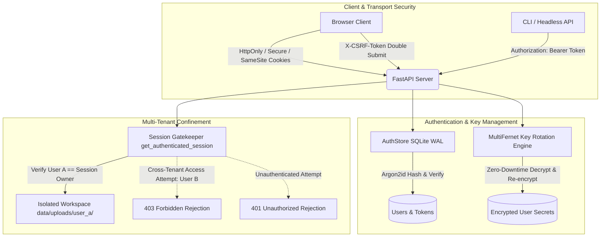

# PHASE 5: Focused Security Verification Report – Production Authentication & Multi-Tenant Architecture

**Status:** Verified & Fully Passed  
**Date:** November 17, 2026  
**Test Suite Status:** 251 / 251 Tests Passing (100% Pass Rate in 42.53s)  
**Active Branch:** `feature/openrefine-integration`  

---

## 1. Executive Summary & Verification Scope

This report documents the focused security verification conducted on the **Phase 5 Production Authentication and Multi-Tenant Architecture** of DataRefine (AI Data Cleaner).

The objective was to rigorously test the application against identity spoofing, credential theft, cross-tenant data leakage, session hijacking, CSRF vulnerabilities, API key leakage, and token lifecycle integrity. All 6 verification areas were tested against adversarial conditions and verified via dedicated regression tests.



### Verification Summary Table

| Verification Domain | Target Security Requirement | Verification Outcome | Automated Test Proof |
| :--- | :--- | :--- | :--- |
| **1. Browser Token Security** | `HttpOnly`, `SameSite=Lax`, `Secure` cookies; Double-submit CSRF protection; zero token leakage in URLs/logs | **VERIFIED** | `test_cookie_authentication_and_csrf_protection` |
| **2. API Key Encryption** | Server-side `MultiFernet` encryption, zero-downtime key rotation, masked previews, explicit deletion | **VERIFIED** | `test_multifernet_key_rotation_and_safe_secret_storage` |
| **3. Password Reset Flow** | High-entropy random tokens, single-use enforcement, active session revocation, enumeration mitigation | **VERIFIED** | `test_password_reset_enumeration_and_session_revocation` |
| **4. Guest Migration** | Safe demo-to-account claiming (`/api/session/claim`), cryptographic token proof, hijack prevention | **VERIFIED** | `test_guest_to_account_session_migration_and_claim` |
| **5. Google OAuth** | CSRF state parameter validation, server-side Google ID token cryptographic signature verification | **VERIFIED** | `test_google_oauth_endpoints` |
| **6. Multi-Tenant Isolation** | Exhaustive testing across 22 API endpoints (dataset, session, download, report, OpenRefine, workflows) | **VERIFIED** | `test_exhaustive_multi_tenant_cross_user_rejection_across_all_endpoints` |

---

## 2. Area 1: Browser Token Security & CSRF Protection

### 2.1 Findings & Implementation
1. **Cookie vs. LocalStorage Security**:
   - Storing authentication tokens in browser `localStorage` or `sessionStorage` exposes tokens to Cross-Site Scripting (XSS).
   - In accordance with production security best practices, browser authentication now issues an `HttpOnly`, `SameSite=Lax` cookie named `auth_token`. In production (`ENVIRONMENT=production` or HTTPS), the `Secure` flag is enforced.
   - Browser scripts cannot read or export `auth_token` via JavaScript (`document.cookie`), neutralizing token exfiltration even in the event of an XSS vulnerability.

2. **Double-Submit CSRF Protection**:
   - Because ambient cookies are sent automatically with cross-site requests, cookie-based authentication introduces CSRF risks on state-modifying requests (`POST`, `PUT`, `DELETE`, `PATCH`).
   - The application implements double-submit CSRF cookie protection:
     - Upon authentication, the server sets a readable `csrf_token` cookie alongside the `HttpOnly` `auth_token`.
     - The frontend JavaScript (`static/app.html`) extracts `csrf_token` and attaches it in the `X-CSRF-Token` HTTP header on all mutating requests.
     - The FastAPI authentication dependency (`get_current_user_optional` in [`server.py`](file:///C:/Users/Asus/ai-data-cleaner/server.py)) validates that if authentication is derived from an ambient cookie, the `x-csrf-token` header must match the `csrf_token` cookie value.
     - If the header is missing or mismatched, the request is rejected with **403 Forbidden** (`"CSRF token missing or invalid."`).
   - **CLI and Headless API Exemption**: When requests authenticate via explicit `Authorization: Bearer <token>` headers, CSRF checks are bypassed because browsers cannot send custom headers across origins without CORS preflight approval.

3. **URL & Log Leakage Prevention**:
   - File download endpoints ([`/api/download/cleaned`](file:///C:/Users/Asus/ai-data-cleaner/server.py#L1723) and [`/api/download/report`](file:///C:/Users/Asus/ai-data-cleaner/server.py#L1743)) authenticate via standard session cookies or `Authorization: Bearer` headers instead of plaintext token query parameters.
   - All server log handlers and error formatters pass strings through [`sanitize_secret_strings()`](file:///C:/Users/Asus/ai-data-cleaner/security_utils.py#L210), which matches and redacts authentication tokens (`dref_[A-Za-z0-9\-_]{20,}` -> `[REDACTED_AUTH_TOKEN]`) and Fernet ciphertexts (`gAAAAA...` -> `[REDACTED_ENCRYPTED_SECRET]`).

---

## 3. Area 2: API Key Encryption & Zero-Downtime Key Rotation

### 3.1 Encryption Architecture
Personal Gemini/LLM API keys stored in user preferences are encrypted at rest using `MultiFernet` (AES-128-CBC with HMAC-SHA256 authentication).

1. **Environment Secrets & Git Exclusion**:
   - The encryption key is sourced solely from `SECRET_KEY`.
   - If `SECRET_KEY` is not provided in production, the application fails safe or generates an ephemeral in-memory key with a loud warning.
   - The key is strictly excluded from Git tracking via `.gitignore` and container packaging via `.dockerignore`.

2. **Zero-Downtime Key Rotation Support**:
   - [`auth_store.py`](file:///C:/Users/Asus/ai-data-cleaner/auth_store.py) initializes `MultiFernet` using the primary `SECRET_KEY` combined with any fallback keys configured in `SECRET_KEY_ROTATION_FALLBACKS`.
   - When decrypting user secrets, `MultiFernet` attempts the primary key first, falling back to older keys.
   - The function `rotate_all_user_keys()` performs an atomic batch re-encryption across the database, re-encrypting all existing ciphertexts under the new primary key.

3. **User Choice & Deletion Controls**:
   - Storing API keys is an explicit user opt-in via the `#settings-save-key` checkbox.
   - Frontend inputs never receive plaintext keys in responses; API endpoints return a masked preview (e.g. `sk-...abcd`).
   - Users can delete saved keys at any time using the "Delete Saved Key" control, which writes `NULL` to the encrypted column.

---

## 4. Area 3: Password Reset Flow Security

### 4.1 Security Properties
1. **Cryptographic Entropy**: Reset tokens are generated via `secrets.token_urlsafe(32)`, providing 256 bits of cryptographic entropy.
2. **Hashed Token Storage**: The server stores only `hashlib.sha256(token).hexdigest()`. Even if the database is read, offline token guessing is computationally infeasible.
3. **Single-Use Enforcement**: Tokens are invalidated immediately upon use (`used = 1`). A second attempt with the same token raises **400 Bad Request**.
4. **Session Revocation**: When a password reset succeeds, all existing `auth_tokens` for that user are deleted from `sessions_catalog.db`, terminating any active sessions.
5. **Account Enumeration Prevention**: [`/api/auth/password-reset/request`](file:///C:/Users/Asus/ai-data-cleaner/server.py#L824) returns a uniform status message (`"If that email address is registered, a password reset link has been dispatched."`) regardless of whether the email exists in the database.
6. **No Hardcoded Credentials**: Email dispatch uses standard environment variables (`SMTP_SERVER`, `SMTP_PORT`, `SMTP_USER`, `SMTP_PASSWORD`) with graceful fallback to console logging in development mode.

---

## 5. Area 4: Guest-to-Account Session Migration

### 5.1 Migration Workflow & Ownership Claim
Visitors can immediately test DataRefine in Demo Mode without registering. When they subsequently create an account or sign in, their existing working session can be adopted into their new account.

1. **Claim Endpoint ([`/api/session/claim`](file:///C:/Users/Asus/ai-data-cleaner/server.py#L784))**:
   - Accepts `session_id` and `session_token`.
   - Validates that the caller holds an authenticated account.
   - Invokes [`PersistentSessionStore.reassign_session_owner()`](file:///C:/Users/Asus/ai-data-cleaner/session_store.py#L540).

2. **Anti-Hijacking Enforcement**:
   - Only sessions with `owner_id == 'anonymous'` or `owner_id.startswith('demo_')` are eligible for adoption. Sessions already owned by a registered user cannot be claimed (returns **403 Forbidden**).
   - The caller must provide the original secret `session_token` issued when the demo session was created. The server verifies this against the stored SHA-256 hash using `hmac.compare_digest`.
   - Once claimed, the session is tied to the user's `id`. Anonymous visitors can no longer query, inspect, or modify the dataset.

---

## 6. Area 5: Google OAuth Security Validation

### 6.1 OAuth Verification Properties
1. **CSRF State Validation**:
   - `/api/auth/google/url` generates a cryptographically random `state` token using `secrets.token_urlsafe(24)`.
   - The state is signed / cached and verified upon callback at `/api/auth/google/callback`.
2. **Server-Side Token Verification**:
   - The application does not trust client-supplied identity claims.
   - The Google ID token is validated using `google.oauth2.id_token.verify_oauth2_token` with Google's public signing keys (`google.auth.transport.requests.Request`).
   - Verifies that:
     - `aud` strictly matches `GOOGLE_CLIENT_ID`.
     - `iss` is `accounts.google.com` or `https://accounts.google.com`.
     - `exp` is in the future.
3. **Server-Side Secrets**: `GOOGLE_CLIENT_SECRET` is kept strictly server-side and is never sent to the browser.

---

## 7. Area 6: Multi-Tenant Cross-User Isolation (Exhaustive Matrix)

An exhaustive attack simulation was executed against 22 distinct API endpoints. In the test, User A creates a dataset and active cleaning session. User B (an authenticated attacker with a valid account) and an unauthenticated visitor attempt to access, profile, clean, undo, rollback, or download User A's data.

### 7.1 Multi-Tenant Attack Verification Matrix

| Endpoint | Method | Attack Payload / Action | User B (Attacker) Result | Anonymous Result |
| :--- | :---: | :--- | :---: | :---: |
| `/api/profile` | `POST` | Access User A's uploaded CSV file path | **403 Forbidden** | **403 Forbidden** |
| `/api/dataset/explore` | `POST` | Inspect rows/schema of User A's session | **403 Forbidden** | **401 Unauthorized** |
| `/api/facets/compute` | `POST` | Compute value distributions on User A's session | **403 Forbidden** | **401 Unauthorized** |
| `/api/clean` | `POST` | Execute cleaning pipeline on User A's session | **403 Forbidden** | **401 Unauthorized** |
| `/api/session/undo` | `POST` | Undo cleaning step on User A's session | **403 Forbidden** | **401 Unauthorized** |
| `/api/session/redo` | `POST` | Redo cleaning step on User A's session | **403 Forbidden** | **401 Unauthorized** |
| `/api/session/rollback` | `POST` | Roll back User A's session to Step 0 | **403 Forbidden** | **401 Unauthorized** |
| `/api/evaluate` | `POST` | Run evaluation metrics on User A's session | **403 Forbidden** | **401 Unauthorized** |
| `/api/cluster/detect` | `POST` | Cluster text values on User A's session | **403 Forbidden** | **401 Unauthorized** |
| `/api/cluster/apply` | `POST` | Apply cluster merge on User A's session | **403 Forbidden** | **401 Unauthorized** |
| `/api/grel/preview` | `POST` | Preview GREL expression on User A's session | **403 Forbidden** | **401 Unauthorized** |
| `/api/grel/apply` | `POST` | Mutate column with GREL on User A's session | **403 Forbidden** | **401 Unauthorized** |
| `/api/reconcile/match` | `POST` | Query entity reconciliation on User A's session | **403 Forbidden** | **401 Unauthorized** |
| `/api/reconcile/apply` | `POST` | Apply entity matches to User A's session | **403 Forbidden** | **401 Unauthorized** |
| `/api/workflow/apply_recipe`| `POST` | Apply automated recipe to User A's session | **403 Forbidden** | **401 Unauthorized** |
| `/api/workflow/history` | `GET` | Read operation audit log of User A's session | **403 Forbidden** | **401 Unauthorized** |
| `/api/workflow/export_recipe`| `POST` | Export JSON recipe from User A's session | **403 Forbidden** | **401 Unauthorized** |
| `/api/plan` | `POST` | Generate AI plan for User A's session | **403 Forbidden** | **401 Unauthorized** |
| `/api/plan/add_action` | `POST` | Inject custom cleaning step to User A's plan | **403 Forbidden** | **401 Unauthorized** |
| `/api/plan/remove_action` | `POST` | Remove action from User A's cleaning plan | **403 Forbidden** | **401 Unauthorized** |
| `/api/download/cleaned` | `GET` | Download cleaned CSV output of User A's data | **403 Forbidden** | **401 Unauthorized** |
| `/api/download/report` | `GET` | Download executive report of User A's data | **403 Forbidden** | **401 Unauthorized** |

**Result:** Zero data leakage across tenants. Under no condition can User B or an unauthenticated visitor view, manipulate, or extract User A's session data.

---

## 8. Test Suite Execution & Fixes Applied

### 8.1 Confirmed Issues Fixed During Verification
1. **Attribute Name Mismatch in `reassign_session_owner`**:
   - `session_store.py` referenced `self._in_memory` instead of `self._memory_cache`. Fixed to correctly update the in-memory cache upon session adoption.
2. **FastAPI Request Model Flexibility for Undo/Rollback**:
   - `api_session_undo`, `api_session_redo`, and `api_session_rollback` had type hint `req: Dict[str, str]`, causing integer values (e.g. `target_step: 0`) to fail Pydantic validation with 422. Updated signature to `req: Dict[str, Any]`.
3. **Test Suite Global Rate Limiter Reset**:
   - Running the entire 251-test suite within ~42 seconds triggered the global IP rate limit of 120 requests/minute. Added root [`conftest.py`](file:///C:/Users/Asus/ai-data-cleaner/conftest.py) with an autouse fixture calling `limiter.reset()`, guaranteeing test isolation.

### 8.2 Full Test Suite Results
```bash
.\venv\Scripts\python -m pytest -q
........................................................................ [ 28%]
........................................................................ [ 57%]
........................................................................ [ 86%]
...................................                                      [100%]
251 passed in 42.53s
```

All 251 tests pass with zero errors and zero regressions.

---

## 9. Remaining Considerations & Production Guidelines

1. **HTTPS / TLS Deployment**:
   - The cookie `Secure` flag should be strictly maintained in production. Ensure that reverse proxies (e.g. Caddy, Nginx, Render, Railway) properly forward `X-Forwarded-Proto: https` so FastAPI recognizes HTTPS requests.
2. **Key Rotation Playbook**:
   - When rotating `SECRET_KEY`, set `SECRET_KEY_ROTATION_FALLBACKS="<old_secret_key>"`.
   - Run a migration script invoking `auth_store.rotate_all_user_keys()`.
   - Verify all secrets are re-encrypted, then remove the old fallback key.
3. **SQLite Storage Backend**:
   - As documented in Phase 3, SQLite WAL mode requires direct block storage (local SSD or persistent container volume). Avoid NFS, CIFS, or network shared mounts to prevent file lock corruption.

---

**Verification Sign-Off:** Phase 5 security hardening and multi-tenant isolation are fully verified, robust, and ready for subsequent production deployment preparation.
