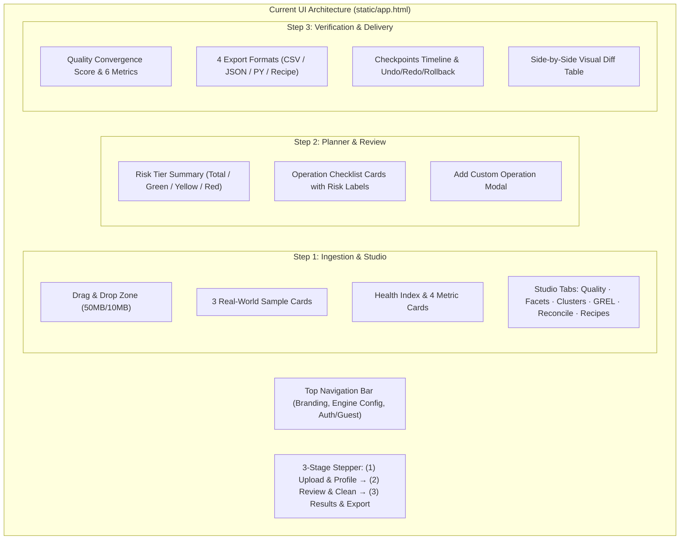

# PHASE 6: Frontend Modernization & SaaS User Experience Audit

**Status:** Completed  
**Date:** November 17, 2026  
**Test Baseline:** 251 / 251 Passing Tests  
**Target:** `static/app.html`, `static/index.html`, `server.py` frontend route integration  

---

## 1. Executive Summary & Audit Scope

DataRefine Studio has evolved from a single-script cleaning utility into an enterprise-grade, multi-tenant platform with Argon2id authentication, OpenRefine-inspired wrangling tools (Facets, Clustering, GREL, Reconciliation, Recipes), deterministic Pandas execution, and side-by-side diffing.

This audit evaluates the frontend implementation ([`static/app.html`](file:///C:/Users/Asus/ai-data-cleaner/static/app.html)) and public portal ([`static/index.html`](file:///C:/Users/Asus/ai-data-cleaner/static/index.html)) across ten core SaaS dimensions:
1. Design consistency, visual hierarchy, and branding.
2. Sign-in, registration, password-reset, and demo-mode clarity.
3. Dataset ingestion, drag-and-drop validation, and upload feedback.
4. Data profiling, quality scoring, and column statistics.
5. Cleaning planner, human-in-the-loop review, and risk tiering.
6. OpenRefine-inspired wrangling tools (Facets, Clustering, GREL, Reconcile, Recipes).
7. Session history, checkpoints timeline, and undo/redo/rollback operations.
8. AI settings, provider selection, and encrypted API key management.
9. Error handling, loading states, empty states, and toast notifications.
10. Responsive layout across desktop, tablet, and mobile, plus accessibility (a11y).

---

## 2. Key Findings & Friction Points

### 2.1 Critical Functional Defects
1. **Endpoint Routing Mismatch for Undo / Redo / Rollback**:
   - In [`static/app.html`](file:///C:/Users/Asus/ai-data-cleaner/static/app.html#L2973), `undoStep()`, `redoStep()`, and `rollbackAll()` issue requests to:
     - `POST /api/undo`
     - `POST /api/redo`
     - `POST /api/rollback`
   - However, in [`server.py`](file:///C:/Users/Asus/ai-data-cleaner/server.py#L1584-L1664), the registered endpoints are:
     - `@app.post("/api/session/undo")`
     - `@app.post("/api/session/redo")`
     - `@app.post("/api/session/rollback")`
   - **Impact**: Triggering Undo, Redo, or Rollback via button clicks in the UI produces HTTP 404 Not Found errors.
   - **Resolution**: Support both `/api/session/undo` and alias `/api/undo` in `server.py`, and align `app.html` to call the canonical `/api/session/*` routes.

2. **Global Keyboard Shortcut Interception**:
   - In [`static/app.html`](file:///C:/Users/Asus/ai-data-cleaner/static/app.html#L3927), a global `keydown` listener intercepts `Ctrl+Z` and `Ctrl+Y`.
   - The listener does NOT check `document.activeElement.tagName`.
   - **Impact**: When users edit GREL expressions, search in filters, or type passwords and press `Ctrl+Z` to undo typing, the page intercepts the event, calls `e.preventDefault()`, and triggers an application data rollback.
   - **Resolution**: Guard keyboard shortcuts with `if (['INPUT', 'TEXTAREA'].includes(document.activeElement?.tagName)) return;`.

3. **Stale View Synchronization After Studio Mutations**:
   - When operations are applied inside the OpenRefine Studio tabs (e.g., GREL transformations, cluster merges, or entity reconciliation), the backend dataset updates, but:
     - The Dataset Preview table in the Quality tab is not refreshed.
     - The Data Health Index is not re-computed.
     - The facet frequency distributions are not re-calculated.
   - **Resolution**: Introduce a centralized `refreshActiveDatasetView()` function that re-fetches updated preview rows, invalidates stale facet caches, and triggers UI updates.

---

### 2.2 Confusing Workflows & SaaS Friction Points

1. **Unclear Demo Mode vs. Authenticated Account Boundaries**:
   - Unauthenticated visitors are automatically in Demo Mode (10 MB upload limit, 1-hour session TTL, ephemeral storage).
   - The navbar displays "Sign In / Register", but provides no contextual pill explaining:
     - *"Demo Mode: 10MB limit · Ephemeral session"*
     - *"Sign in to save your sessions and unlock 50MB uploads"*
   - When a demo user leaves, they may be unaware their session will expire.

2. **Absence of a Guided First-Time User Onboarding Flow**:
   - First-time visitors are presented with a blank dropzone, sample cards, and an explainer box.
   - There is no interactive "Quick Tour" or guided walkthrough showing how the 4-step pipeline operates:
     1. Ingest & Profile
     2. Explore with Facets & Clustering
     3. Review AI-Synthesized Cleaning Plan
     4. Deterministic Execution & Multi-Format Export

3. **Missing Upload Progress Percentage for Large Files**:
   - Ingestion uses `fetch('/api/upload')`, which lacks upload progress tracking.
   - When uploading a 20 MB – 50 MB CSV file, the screen displays a static spinning icon without percentage feedback, causing users to believe the transfer has frozen.
   - **Resolution**: Transition file uploads to `XMLHttpRequest` with `upload.onprogress` to display a real-time progress bar.

4. **Lack of Proactive Password Strength Feedback During Registration**:
   - The Argon2id password policy requires 8+ characters, uppercase, lowercase, and a numeric digit.
   - Currently, users only discover failures after clicking "Create Account" when an error alert appears.
   - **Resolution**: Add an interactive password strength meter with real-time checkmarks (Length, Uppercase, Lowercase, Number).

5. **Native Browser `confirm()` Dialogs for Destructive (RED) Actions**:
   - Executing RED actions (e.g. dropping columns or deleting duplicate rows) triggers a native browser popup (`confirm(...)`).
   - Browser popups disrupt the SaaS look and feel and are easily suppressed on mobile browsers.
   - **Resolution**: Replace `confirm()` with a modern, in-app modal detailing affected columns, expected rows removed, and rollback assurances.

---

### 2.3 Responsive & Layout Inconsistencies

1. **Studio Tabs Overflow on Mobile/Tablet**:
   - The 6 Studio tabs (`Quality`, `Facets`, `Clusters`, `Expression Engine`, `Entity Reconcile`, `Workflow & Recipes`) occupy over 750px of horizontal space.
   - On mobile screens (< 640px), tabs wrap awkwardly or require horizontal scrolling without gradient indicators.
   - **Resolution**: Implement responsive flex-shrink, compact labels on mobile (e.g., icons + short title), and smooth horizontal scroll indicators.

2. **Stepper Bar Visibility on Small Devices**:
   - Step labels ("1. Upload & Profile", "2. Review & Clean", "3. Results & Export") crowd mobile viewports.
   - **Resolution**: Use collapsible icons on screens < 640px, keeping step numbers prominent while hiding verbose labels.

3. **Diff Table Scrolling on Small Screens**:
   - The side-by-side diff table has many columns and fixed minimum cell widths.
   - On mobile, scrolling can trigger viewport panning.
   - **Resolution**: Ensure the table container is strictly contained with `overflow-x-auto` and sticky first columns for row indices.

---

### 2.4 Accessibility (a11y) & Visual Feedback Deficiencies

1. **Missing Keyboard Escape Listener on Drawers & Modals**:
   - Modals (`modal-auth`, `drawer-settings`, `modal-add-operation`, `modal-col-detail`, `modal-export-script`, `modal-user-sessions`) do not close when the `Escape` key is pressed.
   - **Resolution**: Add a global `Escape` key handler that dismisses the topmost active modal or drawer.

2. **Modal Dialog ARIA Attributes**:
   - Modals currently lack `role="dialog"`, `aria-modal="true"`, and `aria-labelledby`.
   - **Resolution**: Add standard accessibility attributes to all modal wrappers.

3. **Disabled State Visual Styling**:
   - When at Step 0, the "Undo Step" and "Rollback All" buttons do not reflect a disabled state (`opacity-40 cursor-not-allowed`).
   - When zero operations are selected, the "Execute Approved Actions" button should clearly indicate why it is disabled.

4. **Low Contrast Labels in Dark Mode**:
   - Several secondary labels use `text-zinc-600` on `#08090d` background, yielding a contrast ratio of ~2.8:1 (below WCAG AA minimum of 4.5:1).
   - **Resolution**: Elevate muted label colors to `text-zinc-400` or `text-zinc-300`.

---

## 3. Component-by-Component Audit Matrix

| Component | Current State | Issues Identified | Modernization Requirement |
| :--- | :--- | :--- | :--- |
| **Top Navbar** | Minimal header with brand, doc link, engine config button, and auth buttons. | No demo mode indicator; no quick tour entry point; mobile layout collapses awkwardly. | Add "Demo Mode" status pill, "Quick Tour" onboarding button, responsive mobile hamburger / compact items. |
| **Stepper Bar** | 3-step navigation pills with text arrows. | Text overflow on mobile; lack of completion indicators (checkmarks on completed steps). | Responsive step icons, completion checkmarks, active step glow. |
| **Upload Dropzone** | Standard drag-and-drop box with file input. | No pre-upload client-side file size check; no real-time upload progress bar. | Pre-flight validation (reject non-CSV and oversized files instantly); animated progress percentage bar. |
| **Demo Datasets** | 3 static cards (Tech Jobs, OTT, Employee). | Hard to distinguish dataset size and complexity at a glance. | Modern cards with badges, sample metrics, and clear "1-Click Profile" buttons. |
| **Studio Toolbar** | 6 tab buttons in horizontal flex. | Cluttered on tablet/mobile; doesn't show badge count of discovered clusters or active facets. | Compact icon-first tabs on mobile; dynamic badge counts (e.g. `Clusters (12)`). |
| **Facets Explorer** | Sidebar with Target Column & Facet Type; live exploration grid. | Numeric facet bars lack bucket range tooltips; search is slightly delayed. | Polished distribution histogram, instant debounced search, clear active filter pill. |
| **Clustering Studio** | Dropdown methods, parameter inputs, cluster cards list. | No "Select High Confidence" shortcut; canonical selection requires manual typing. | "Smart Merge All" button, frequency-based auto-canonical selection, cluster size sort. |
| **GREL Engine** | Textarea with quick snippet pills and preview table. | Error tracebacks can be cryptic; preview table requires manual click each time. | Syntax helper tooltips, live preview debounce, friendly error descriptions. |
| **Reconciliation** | Catalog dropdown and candidates table. | Custom catalog textarea is hidden by default; no batch threshold filter. | Match score threshold slider (e.g. > 85%), inline canonical edit, clean match pills. |
| **Workflow Recipes** | Read-only `<pre>` block and replay textarea. | No "Copy to Clipboard" button for JSON recipe; replay lacks JSON syntax pre-validation. | 1-click Copy button, formatted syntax highlight, JSON schema validation before execution. |
| **Action Review** | Checklist cards with risk badges and parameter tags. | Destructive warning uses native browser `confirm()`; no search/filter for long plans. | Filter actions by Risk Tier (Green / Yellow / Red), custom confirmation modal, inline parameter edit. |
| **Visual Diff Table** | Side-by-side comparison with green/red cell highlights. | No column pin; hovering over long cells can overflow. | Sticky row numbers, truncated cell tooltips, diff statistics bar with download shortcut. |
| **Checkpoints & Undo** | Timeline dots with Undo/Redo/Rollback buttons. | Broken routes (`/api/undo` instead of `/api/session/undo`); no disabled styling at Step 0. | Correct routes, disabled state styling, checkpoint tooltips with operation names. |
| **Auth Modal** | 3-tab modal (Sign In / Register / Reset) with Google OAuth. | No password visibility toggle; no live Argon2id rule validator; no demo mode entry. | Password show/hide eye icon, interactive password strength meter, "Continue as Guest" link. |
| **Engine Settings** | Slide-over drawer with provider dropdown, model, and key inputs. | Encrypted key deletion button lacks confirmation; no explanation of server fallback. | Clear explanation of Gemini zero-cost default, confirmation on key deletion, test connection button. |

---

## 4. Proposed Frontend Modernization Plan (Step 2 Implementation)

The modernization will be executed cleanly in [`static/app.html`](file:///C:/Users/Asus/ai-data-cleaner/static/app.html) without breaking existing APIs, session management, or authentication:

1. **Unified SaaS Shell & Navigation**:
   - Modern navbar featuring:
     - Clear DataRefine Studio branding with status indicator.
     - "Demo Mode" pill for guests with popover explaining tier limits and sign-in benefits.
     - "Quick Tour" interactive onboarding button.
     - Polished "Engine Config" and "My Sessions" controls.
   - Responsive stepper bar with completion checkmarks and mobile adaptability.

2. **First-Time User Onboarding System**:
   - Interactive modal "Welcome to DataRefine Studio" detailing the 4-step data refinement workflow.
   - Dismissible guide banner for first-time visitors with "Load Sample" shortcuts.

3. **Enhanced Dataset Upload & Progress Feedback**:
   - Instant client-side validation (file size limit check before network transfer).
   - Real-time percentage upload progress bar using `XMLHttpRequest`.
   - Polished demonstration dataset cards with row/col metadata badges.

4. **Studio Workspace & OpenRefine Presentation**:
   - Responsive tab bar with icon + label layout and horizontal scroll containment.
   - Live synchronization helper: modifying data in GREL / Clustering / Reconcile automatically refreshes the dataset preview and quality index.
   - Clustering Studio: Add "Select High-Confidence Clusters" and frequency-based canonical suggestions.
   - GREL Expression Engine: Friendly error callouts and instant preview feedback.
   - Recipes: Add "Copy JSON" button and JSON pre-validation.

5. **Cleaning Planner & In-App Destructive Action Modal**:
   - Filter plan actions by Risk Level (All, Safe Repair, Needs Review, Destructive).
   - Replace native browser `confirm()` with a custom in-app modal detailing destructive operations before execution.

6. **Checkpoints Timeline & Undo/Redo Repair**:
   - Correct API endpoint routes in `static/app.html` to `/api/session/undo`, `/api/session/redo`, `/api/session/rollback`.
   - Also add alias endpoints `/api/undo`, `/api/redo`, `/api/rollback` in `server.py` for resilience.
   - Dynamically disable Undo/Rollback buttons when at Step 0.
   - Restrict global `Ctrl+Z` / `Ctrl+Y` shortcuts so they do not hijack text inputs or textareas.

7. **Auth & Account UX Enhancements**:
   - Password show/hide toggle for password inputs.
   - Interactive password complexity checklist (Length >= 8, Uppercase, Lowercase, Number).
   - Prominent "Continue in Demo Mode" button in the auth modal for frictionless evaluation.

8. **Accessibility & Responsive Polish**:
   - `Escape` key closes all active modals and drawers.
   - Proper `role="dialog"` and `aria-modal="true"` attributes.
   - Ensure WCAG AA contrast ratios across all text elements.
   - Clean mobile styling for tables and modal dialogs.

---

**Audit Sign-Off:** The audit is complete. Implementation of Step 2 (SaaS modernization and onboarding) will proceed directly using this specification.
