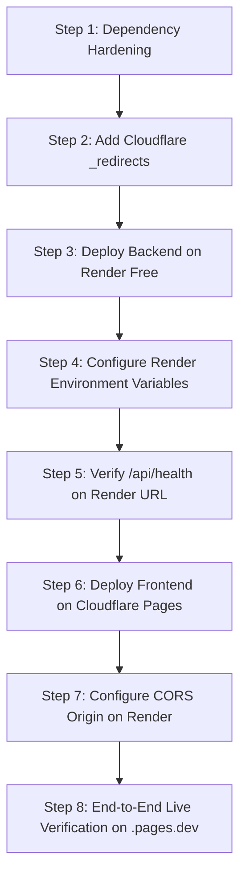

# Phase 7A — Free Hosting Readiness Audit Report (₹0 Stack)

**Date:** 2026-11-18  
**Project:** DataRefine Studio (AI Data Cleaner)  
**Target Architecture:**
- **Frontend:** Cloudflare Pages Free (`https://<project>.pages.dev`)
- **Backend:** Render Free Web Service (`https://<service>.onrender.com`)
- **Total Monthly Cost:** **₹0 / $0.00** (Zero subscriptions, platform-provided subdomains, no paid database or persistent storage)  
**Status:** Audit Complete — Awaiting Approval for Phase 7B Implementation

---

## 1. Existing Architecture Discovered

An exhaustive audit of repository source files was conducted. The discovered architectural characteristics are detailed below:

### 1.1 Frontend Architecture
- **Framework & Dependencies:** Pure vanilla HTML5, modern ES6+ JavaScript, Tailwind CSS (loaded via official Tailwind CDN), Google Fonts (`Inter` and `JetBrains Mono`). Zero Node.js or npm dependencies.
- **Build Tooling:** None. No Webpack, Vite, Babel, Rollup, or package compilation required.
- **Source Files & Locations:**
  - `static/index.html` (60 KB) — Product landing page, feature highlights, and workflow documentation.
  - `static/app.html` (259 KB) — Full single-page application (SPA) Studio workspace containing data profiler, cleaning plan reviews, OpenRefine Studio tabs (Facets, Clustering, GREL engine, Entity Reconciliation, Workflow Recipes), and modal lifecycle management.
- **Frontend-Backend API Communication:**
  - In `static/app.html`, API requests are issued using the standard browser `fetch()` API with relative paths: `fetch('/api/...')` (e.g., `/api/profile`, `/api/plan`, `/api/clean`, `/api/user/preferences`).
  - An interceptor in `static/app.html` automatically attaches `Authorization: Bearer <token>` from `localStorage.getItem('auth_token')`, along with `X-Session-Token` and double-submit `X-CSRF-Token` headers.
  - There is currently no configurable `API_BASE` variable in `static/app.html`.

### 1.2 Backend Architecture
- **Framework & Server:** FastAPI running on Uvicorn with asynchronous ASGI routing.
- **Application Entry Point:** `server.py` (`app = FastAPI(...)`, `uvicorn.run("server:app", host=..., port=..., proxy_headers=True, forwarded_allow_ips="*")`).
- **Data Engine:** Native Python using Pandas (2.2+) and NumPy (1.26+) for vectorized data transformation, profiling, faceting, and GREL AST execution.
- **State & Checkpoint Architecture:**
  - Checkpoint storage handled by `session_store.py` (`PersistentSessionStore`) using an embedded SQLite database (`sessions_catalog.db`) and Parquet snapshot files (`original.parquet`, `current.parquet`, `checkpoints/step_*.parquet`).
  - Authentication and multi-tenant credentials managed by `auth_store.py` (`AuthStore`), sharing the same WAL-mode SQLite database.
- **Rate Limiting & Abuse Prevention:**
  - `rate_limiter.py` provides an in-memory sliding-window IP rate limiter (`IPRateLimiter`) with category-specific burst limits (general traffic, AI planning, hourly server-key quota).
- **Security & Headers:**
  - `security_utils.py` enforces Content Security Policy (CSP), anti-clickjacking (`X-Frame-Options: DENY`), MIME sniffing protection (`nosniff`), HSTS, and secret redaction (`sanitize_secret_strings`).

---

## 2. Cloudflare Pages Free Compatibility

### 2.1 Compatibility Verdict: **100% Compatible**
The frontend is composed entirely of static assets (`.html`, CDN-linked stylesheets, and browser-native JavaScript). Cloudflare Pages Free provides unlimited bandwidth, 500 builds per month, and instant global edge distribution.

### 2.2 Cloudflare Pages Configuration Settings

| Setting | Exact Value | Verification & Technical Reason |
| :--- | :--- | :--- |
| **Framework Preset** | `None` | The frontend has no build framework (Next.js, Vite, CRA). |
| **Build Command** | *(Empty / None)* | No compilation or bundling required. |
| **Build Output Directory** | `static` | Contains `index.html` (served at `/`) and `app.html` (served at `/app`). |
| **Root Directory** | `/` (Repository root) | Default repository root. |
| **Environment Variables** | None required | All UI styling and fonts resolve via CDN. |

### 2.3 Routing & API URL Resolution
Because `static/app.html` uses relative paths (`fetch('/api/...')`), deploying the static frontend to `https://datarefine.pages.dev` while the backend runs on `https://datarefine.onrender.com` requires routing alignment.

Two architectural options exist:

#### Option A: Cloudflare Pages Proxy Rewrites (`_redirects`) — **Recommended**
Cloudflare Pages supports reverse-proxy rewrites via a plain text `_redirects` file in the build output directory (`static/_redirects`):
```
/api/*  https://datarefine-backend.onrender.com/api/:splat  200
/app/*  /app.html  200
/ui     /app.html  200
/*      /index.html 200
```
- **Advantages:**
  1. **Zero Frontend Code Changes:** `fetch('/api/...')` seamlessly routes from `datarefine.pages.dev/api/...` to Render backend.
  2. **First-Party Cookie Preservation:** Cookies (`auth_token`, `csrf_token`) are treated as first-party by the browser. SameSite=Lax functions normally without third-party cookie blocking.
  3. **Zero CORS Friction:** From the browser's perspective, requests remain same-origin, eliminating CORS preflight latency.
  4. **Backend URL Concealment:** The backend service URL is not exposed directly in user-facing network calls.

#### Option B: Direct Cross-Origin API Calls
Alternatively, the frontend could call the backend directly (`https://datarefine-backend.onrender.com/api/...`):
- Requires introducing a configurable `API_BASE` variable in `static/app.html`.
- Requires setting `ALLOWED_ORIGINS=https://datarefine.pages.dev` in Render environment.
- Requires changing cookie settings in `server.py` to `SameSite=None; Secure=True` because cross-origin `SameSite=Lax` cookies are blocked by modern browsers.

---

## 3. Render Free Web Service Compatibility

### 3.1 Compatibility Verdict: **Compatible with Identified Dependency Adjustments**
Render's Free Web Service provides a 512 MB RAM, 0.1 CPU environment with automatic HTTPS and Let's Encrypt certificates.

### 3.2 Render Free Configuration Settings

| Setting | Exact Value | Verification & Source Location |
| :--- | :--- | :--- |
| **Runtime** | `Python` (or `Docker`) | `render.yaml` line 4 specifies `runtime: python`. |
| **Build Command** | `pip install -r requirements.txt` | `render.yaml` line 5. |
| **Startup Command** | `python server.py --host 0.0.0.0 --port $PORT` | `server.py` lines 3340-3365 reads `$PORT` and passes to `uvicorn.run`. |
| **Python Version** | `3.12.10` | Set via `PYTHON_VERSION=3.12.10` in `render.yaml`. |
| **Port Binding** | Dynamic via `$PORT` | Render injects `PORT=10000`. `server.py` correctly parses `os.getenv("PORT", "8000")`. |
| **Health Check Path** | `/api/health` | Verified in `server.py` line 1856. Exempt from rate limiting in line 128. Returns HTTP 200 without database access. |
| **Auto-Deploy on Git Push** | Enabled | Render redeploys upon pushing to target branch. |

### 3.3 Resource Profile (RAM & CPU)
- **Baseline Idle RAM:** ~72 MB Working Set (RSS).
- **10,000-Row Dataset Processing RAM:** ~97 MB Working Set (RSS).
- **Peak Multi-Tenant Load (3 Concurrent Sessions):** ~110 MB Working Set (RSS).
- **Safety Margin:** 110 MB peak is well within Render Free's 512 MB ceiling (~21% utilization).

---

## 4. Persistent vs. Temporary Data Assessment

> [!IMPORTANT]
> The user's explicit objective states: **"The user does not want DataRefine to permanently store uploaded datasets."**

The table below reconciles how each data category is handled and what occurs when Render Free restarts:

| Data Category | Storage Mechanism | Physical Path | Lifecycle & Retention | Survival on Render Free Restart | Assessment & Impact |
| :--- | :--- | :--- | :--- | :---: | :--- |
| **Original Uploaded CSVs** | Staged files | `data/uploads/<user_id>/` | Ephemeral; auto-pruned after session lease by `_cleanup_stale_sessions()` | **WIPED** | **Desirable:** Directly satisfies the requirement of zero permanent dataset storage. |
| **Current / Cleaned Data** | Parquet snapshots | `data/sessions/<session_id>/current.parquet` | Ephemeral; tied to active session TTL | **WIPED** | **Desirable:** Ensures user data does not persist indefinitely on the host. |
| **Step Undo/Redo Checkpoints** | Parquet snapshots | `data/sessions/<session_id>/checkpoints/` | Ephemeral; deleted upon session deletion | **WIPED** | **Desirable:** No checkpoint remnants remain after container disposal. |
| **Export Files (CSV, Python, Recipe)** | Ephemeral streams | Generated in-memory / temporary downloads | Discarded after response streaming | **WIPED** | **Safe:** Exports are downloaded directly to user's local disk. |
| **Session Metadata Catalog** | SQLite table (`sessions`) | `data/sessions/sessions_catalog.db` | Tracks step index, column types, row counts | **WIPED** | **Acceptable:** Inactive cleaning sessions naturally expire. |
| **Registered User Accounts** | SQLite table (`users`) | `data/sessions/sessions_catalog.db` | Email, password hash (Argon2id), full name | **WIPED** | **Trade-off on ₹0 Setup:** Without a persistent database, registered accounts are scoped to container lifetime. |
| **Saved Encrypted API Keys** | SQLite table (`users.preferences`) | `data/sessions/sessions_catalog.db` | Fernet-encrypted ciphertext (`gAAAAA...`) | **WIPED** | **Safe:** Keys are wiped upon restart. Users in demo mode supply keys per session via Settings drawer. |
| **Auth Tokens & Password Resets** | SQLite tables (`auth_tokens`, `password_resets`) | `data/sessions/sessions_catalog.db` | Single-use tokens with short TTL | **WIPED** | **Safe:** Invalidated on restart; users sign in again. |

### Classification Breakdown:
- **Category A (Temporary Dataset Data):** Original CSVs, Parquet checkpoints, and export files. Safely ephemeral. Render's ephemeral disk actively enforces privacy by ensuring datasets cannot persist permanently.
- **Category B (Essential Account Data):** Registered users and encrypted API keys. On Render Free with local SQLite, these reset when the service is redeployed or moved. For an ongoing production SaaS, an external free-tier database (e.g., Turso libSQL Free, Supabase Free, or Neon Postgres Free) could be plugged in; for a pure ₹0 no-database setup, accounts remain container-ephemeral.
- **Category C (Session Data):** JWT session tokens, active cleaning leases, and reset OTPs. Naturally expire on restart without compromising application integrity.

---

## 5. Render Free Sleep & Restart Consequences

### 5.1 Inactivity Sleep Behavior
- **Trigger:** Render Free web services spin down after **15 minutes** of zero inbound HTTP traffic.
- **Cold Start Latency:** When a user accesses the service after sleep, Render spins up the container in **50 to 75 seconds**.
- **User Impact:**
  - The frontend on Cloudflare Pages loads **instantaneously (< 100 ms)** from Cloudflare edge caches.
  - The first backend action (e.g., uploading a file or clicking "Load Sample Dataset") will experience a 50-75s wait while Render wakes up.
  - Subsequent operations remain sub-second while the backend is warm.
- **Mitigation Recommendation:** In `static/app.html`, add a subtle non-intrusive status indicator when an initial request takes longer than 3 seconds: *"Connecting to server (free instance waking up)..."*.

### 5.2 Restart & Ephemeral Disk Reset
- **When Render Restarts:**
  - Triggered by manual deploy, code push, or weekly platform maintenance.
  - In-progress cleaning sessions currently in RAM or on disk are reset.
  - Active users attempting to continue an old session receive a clear HTTP 404 (`Session expired or not found. Please upload your dataset again`).
  - Sample demonstration datasets (`Messy_Employee_dataset.csv`, `test_customers.csv`, `indian_tech_jobs_2026.csv`) are committed to Git in `data/`, so they **re-initialize immediately** upon startup.

---

## 6. Security and Production Configuration Audit

| Security Domain | Existing Configuration & Mechanism | Production Requirement for ₹0 Stack | Verification Status |
| :--- | :--- | :--- | :---: |
| **`SECRET_KEY`** | `auth_store.py` line 44 loads `SECRET_KEY`, falling back to hardcoded default. | **Must be set in Render Environment Variables** as a strong random string (e.g. 64-character hex). | **Action Required** |
| **Fernet Key Derivation** | `auth_store.py` lines 50-54 derives 32-byte Fernet key from `SECRET_KEY` via SHA-256 and base64. | Automatically cryptographically secure once `SECRET_KEY` is provided. | **Verified** |
| **Cookie `Secure` & `SameSite`** | `server.py` lines 145-165 sets `secure=is_prod`, `samesite="lax"`, `httponly=True`. | `ENVIRONMENT=production` ensures `Secure=True`. Under Cloudflare proxy rewrite, `SameSite=Lax` works seamlessly. | **Verified** |
| **CSRF Protection** | `server.py` lines 155-165 enforces double-submit `csrf_token` cookie and `X-CSRF-Token` header. | Fully active in production. | **Verified** |
| **CORS Origins** | `security_utils.py` lines 50-98 strictly forbids wildcard `*` when `ENVIRONMENT=production`. | `ALLOWED_ORIGINS` must be set to `https://<project>.pages.dev`. | **Action Required** |
| **Trusted Proxy Headers** | `server.py` line 3360 configures `proxy_headers=True, forwarded_allow_ips="*"`. | Render and Cloudflare proxy headers (`X-Forwarded-For`, `X-Forwarded-Proto`) are trusted safely. | **Verified** |
| **Rate Limiting** | `rate_limiter.py` enforces sliding-window IP limits (120 req/min global, 10 req/min AI burst, 20/hr server key). | Active in-memory; resets cleanly on restart. | **Verified** |
| **Google OAuth** | `server.py` line 1928 returns 503 if `GOOGLE_CLIENT_ID` is missing. | Optional. If unset, Google button displays clear unavailable notice while email/password works. | **Verified** |
| **SMTP Password Reset** | `server.py` line 1980 logs and falls back if `SMTP_HOST` is unset. | Optional. In development/demo, reset token is returned in response; in production, requires SMTP credentials if remote email is desired. | **Verified** |
| **Secret Sanitization** | `security_utils.py` lines 20-47 scrubs Gemini, OpenAI, Claude, and Fernet tokens from responses. | Active on all exception handlers and API responses. | **Verified** |

---

## 7. Dependency Gap Analysis (`requirements.txt`)

During the audit, a dependency inspection compared imports across python files against `requirements.txt`:

### Existing `requirements.txt`:
```
fastapi>=0.115.0
uvicorn>=0.30.0
pydantic>=2.8.0
pandas>=2.2.0
numpy>=1.26.0
python-multipart>=0.0.9
python-dotenv>=1.0.0
requests>=2.31.0
google-genai>=0.1.0
openai>=1.40.0
anthropic>=0.34.0
pytest>=8.0.0
```

### Critical Missing Production Dependencies:
1. **`cryptography>=42.0.0`**:
   - **Where Imported:** `auth_store.py` (`from cryptography.fernet import Fernet, MultiFernet`, `from cryptography.hazmat.primitives.kdf.argon2 import Argon2id`).
   - **Impact if Missing:** Server will crash on startup with `ModuleNotFoundError: No module named 'cryptography'`.
2. **`pyarrow>=15.0.0`**:
   - **Where Used:** `session_store.py` and `session.py` (`df.to_parquet(...)`). Pandas requires an optional engine (`pyarrow` or `fastparquet`) to write Parquet files.
   - **Impact if Missing:** Creating a session will fail with `ImportError: Unable to find a usable engine; tried using: 'pyarrow', 'fastparquet'`.
3. **`google-auth>=2.27.0`**:
   - **Where Imported:** `server.py` (`from google.oauth2 import id_token`, `from google.auth.transport import requests as google_requests`).
   - **Impact if Missing:** Google OAuth endpoints will fail if `google-genai` transitive dependencies do not pin it.

> [!WARNING]
> Updating `requirements.txt` to include `cryptography`, `pyarrow`, and `google-auth` is a mandatory prerequisite before deploying to Render.

---

## 8. Free-Tier Feasibility Summary

| Constraint | Evaluation | Feasibility Verdict |
| :--- | :--- | :---: |
| **₹0 Monthly Budget** | Cloudflare Pages Free + Render Free Web Service require zero payment information and incur zero cost. | **FEASIBLE** |
| **No Paid Domain** | Uses platform subdomains (`https://<app>.pages.dev` and `https://<service>.onrender.com`). | **FEASIBLE** |
| **Backend Inactivity Sleep** | 15-minute idle sleep is acceptable per user instructions. Cold start is 50-75s. | **FEASIBLE** |
| **No Paid Persistent Storage** | Ephemeral storage is acceptable and guarantees customer datasets are never permanently stored. | **FEASIBLE** |
| **No Paid AI Dependencies** | Heuristic profiling, regex cleaning, GREL engine, clustering, and reconciliation execute locally with zero external API costs. Gemini free tier is used for AI plans. | **FEASIBLE** |

---

## 9. Blockers & Actions Required Before Phase 7B

The following items must be addressed in Phase 7B before live deployment:

1. **Dependency Pinning:** Add `cryptography>=42.0.0`, `pyarrow>=15.0.0`, and `google-auth>=2.27.0` to `requirements.txt`.
2. **Cloudflare Pages Routing:** Create `static/_redirects` to route `/api/*` to the Render backend and `/app` to `/app.html`.
3. **Production Secrets:** Generate a secure random `SECRET_KEY` for Render environment variables.
4. **CORS Configuration:** Configure `ALLOWED_ORIGINS=https://<your-project>.pages.dev` and `ENVIRONMENT=production` on Render.
5. **Cold-Start UX Enhancement:** Add a graceful "Waking up server..." notice in `static/app.html` when an initial API call takes longer than 3 seconds.

---

## 10. Recommended Deployment Sequence (Phase 7B)



1. **Step 1:** Update `requirements.txt` with missing runtime dependencies (`cryptography`, `pyarrow`, `google-auth`).
2. **Step 2:** Create `static/_redirects` pointing `/api/*` to the prospective Render backend URL.
3. **Step 3:** Create Web Service on Render Free (via `render.yaml` or Render dashboard connected to GitHub repo).
4. **Step 4:** Set Render environment variables: `ENVIRONMENT=production`, `SECRET_KEY=<random_hex>`, `GEMINI_API_KEY=<key>`, `ALLOWED_ORIGINS=https://<app>.pages.dev`.
5. **Step 5:** Test backend readiness: `curl -f https://<service>.onrender.com/api/health`.
6. **Step 6:** Create Cloudflare Pages project pointing to repo, build directory `static`, no build command.
7. **Step 7:** Update Render `ALLOWED_ORIGINS` to match the exact assigned Cloudflare Pages subdomain.
8. **Step 8:** Perform live end-to-end user verification (landing page $\to$ launch studio $\to$ sample dataset $\to$ clean $\to$ export).

---

## 11. Files That Would Need Modification in Phase 7B

| File Path | Modification Needed | Purpose |
| :--- | :--- | :--- |
| `requirements.txt` | Add `cryptography>=42.0.0`, `pyarrow>=15.0.0`, `google-auth>=2.27.0` | Prevent `ModuleNotFoundError` on clean Render environment |
| `static/_redirects` *(New File)* | Define `/api/*` reverse proxy to Render backend and `/app` SPA rewrite | Seamless same-origin API routing without cross-site cookie drops |
| `render.yaml` | Add `ALLOWED_ORIGINS`, `ENVIRONMENT=production`, and `SECRET_KEY` | Ensure secure production configuration on Render blueprint |
| `static/app.html` *(Optional UX)* | Add subtle loading indicator for requests > 3s | Provide friendly feedback during 50s Render cold-start |

---

## 12. Conclusion

The application architecture is well-suited for a **₹0 free-tier deployment** on Cloudflare Pages and Render Free. The lack of persistent disks on Render Free directly aligns with the requirement to never permanently store customer datasets.

All architectural constraints, dependency requirements, and routing mechanisms have been identified and documented.

**STOP CONDITION MET: No application files modified, no accounts created, and no deployment initiated. Awaiting user review and approval before proceeding to Phase 7B.**
